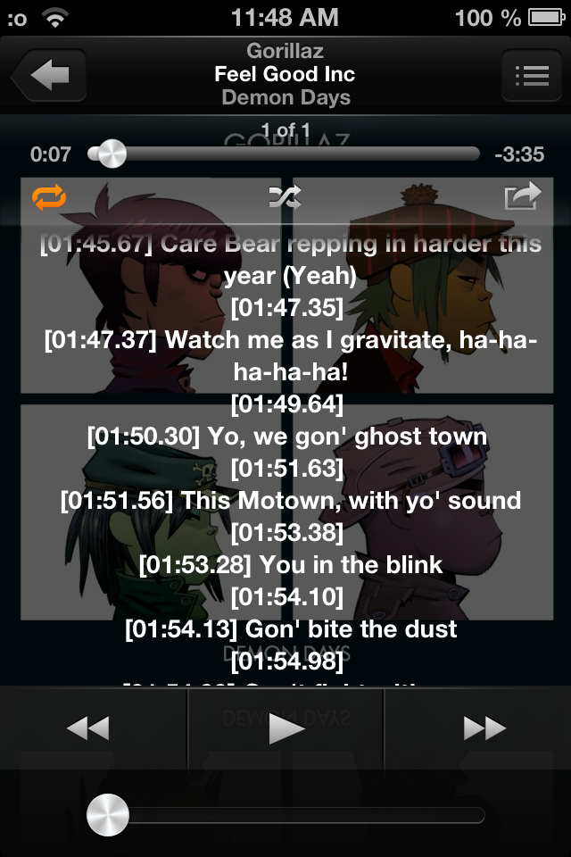
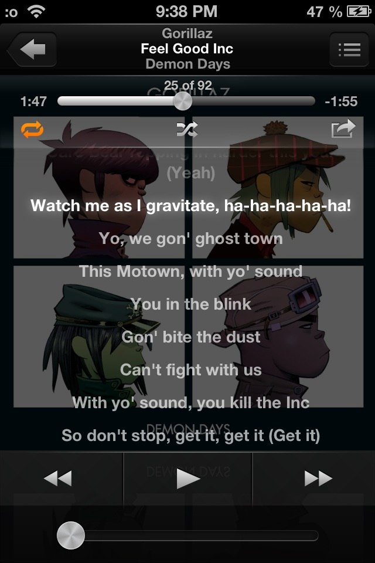

# LyricSync

**Synchronized (LRC) lyrics with an iOS 6 skeuomorphic glow for the Music app on iPhone.**

Stock iOS 6 renders song lyrics as plain scrolling text — timestamps embedded in LRC-formatted
lyrics are shown as garbage. LyricSync parses the timestamps, highlights the currently playing
line with a soft glow and auto-scrolls the text in sync with playback.
Made with GLM 5.3 Flash and Gemini 3.8 Flash

| Before (stock iOS 6) | After (LyricSync) |
|---|---|
|  |  |

## Features

- **Line-by-line sync** — parses `[mm:ss.xx]` markers from the lyrics tag of the playing track
- **Skeuomorphic glow** — the active line glows softly (slide-to-unlock style); past lines fade out
- **Auto-scroll** — the active line is kept at the upper third of the view; never fights your finger
- **Graceful fallback** — lyrics without timestamps render exactly as stock; the tweak stays passive
- **Scroll-to-read** — manual scrolling always wins over auto-scroll
- Lightweight: one 0.25 s timer tick ≈ a few microseconds while lyrics are on screen

## Requirements

- iPhone / iPod touch on **iOS 6.0 – 6.1.3** (armv7)
- MobileSubstrate (Cydia Substrate)

## Install and usage

Grab the `.deb` from [Releases](../../releases) and install:

```bash
dpkg -i com.coteyka.lyricsync_*.deb
```
or add the `http://coteyka.qzz.io` repo to your Cydia app

Then, add grab the lyrics in LRC format, and add them to your song through iTunes

## Supported lyrics format

Standard single-line LRC in the `lyrics` metadata tag:

```
[00:06.48] Feel good
[00:07.30] Sha, sha-ba-da, sha-ba-da-ca; feel good
[00:07.77]
[00:34.60] City's breaking down on a camel's back
```

- `[mm:ss]` and `[mm:ss.xx]` / `[mm:ss.xxx]` are both accepted
- Lines containing only a timestamp (end-of-line markers) are dropped — this alone already
  makes the view cleaner than stock
- Fewer than 2 timestamped lines → stock rendering, tweak passive

## How it works

On iOS 6 the Music app renders lyrics as **HTML inside `MPWebDocumentView`** (legacy WebKit)
embedded in `MPTextView`. LyricSync:

1. Hooks `-[MPWebDocumentView setContentWithString:stylesheet:]` — the input is *plain text*
   (newlines, no `<br>`; WebKit generates those itself), parses LRC from it and feeds the
   metadata to a sync engine *before* `%orig` (the web load is synchronous, and
   `webViewDidFinishLoading:` fires inside it);
2. On load completion rebuilds the DOM through `[[webView] stringByEvaluatingJavaScriptFromString:]`:
   one `<div>` per line + injected CSS;
3. A 0.25 s timer reads `[[MPAVController sharedInstance] currentTime]`, binary-searches the
   active line and toggles the `.now` class + smooth-scrolls `MPTextView._scrollView`.

Two iOS 6 WebKit quirks worth knowing (each cost a crash to find):

- The plain-text content is **re-rendered asynchronously by the WebThread** a second or so after
  load and wipes the rebuilt DOM — the engine verifies the DOM health (`N:offset` protocol from
  `__ls_set`) and rebuilds on mismatch;
- `stringByEvaluatingJavaScriptFromString:` on a raw `WebView` **must** be wrapped in
  `WebThreadLock()` / `WebThreadUnlock()` (C exports from WebCore), otherwise a probabilistic
  `SIGTRAP` in WebCore races with web-thread activity.

## Build

Requires [theos](https://github.com/theos/theos) with an iOS 6.1 SDK:

```bash
export THEOS=~/theos
git clone https://github.com/<you>/LyricSync.git && cd LyricSync
make package FINALPACKAGE=1
```

Debug logging: set `#define LS_DEBUG 1` in `Tweak.xm`, rebuild, then `grep LyricSync /var/log/syslog`.

## License

[MIT](LICENSE)
